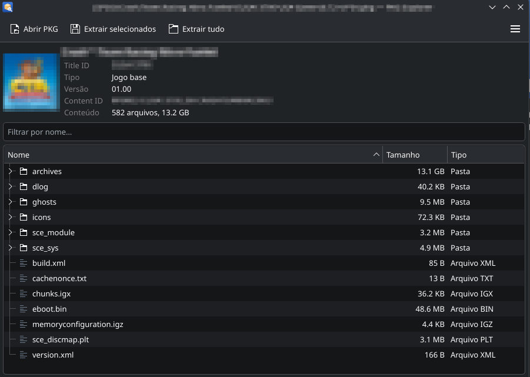

# PKG Explorer

**English** | [Português](README.pt-BR.md)

A graphical tool to browse the contents of PS4 `.pkg` files as if they were an archive
(zip/tar.gz) and extract only the files or folders you want.



- Opens a PKG in under a second, even when it is tens of GB: only the structure is read.
- Shows the game icon, title, Title ID, type (base game, update or DLC) and version.
- Extract selected files or folders, or the whole package (with the same folder names as the
  shadPS4 extractor: `CUSA00000`, `CUSA00000-patch`, `CUSA00000/<DLC>`).
- **Install in shadPS4**: puts a game, update or DLC straight into the right shadPS4 folder
  (see [Install in shadPS4](#install-in-shadps4)).
- Drag files and folders from the window to your file manager, like with a zip
  (see [KDE Plasma and other desktops](#kde-plasma-and-other-desktops)).
- Double-click a file to open it with its default application.
- Filter by name.
- File association: double-click a `.pkg` in your file manager to open it.
- English and Portuguese interface, chosen from the system language.

Supports the same PKGs as the shadPS4 extractor ("fake"/fpkg packages).

## Installation

### AppImage

Download `PKG-Explorer-x86_64.AppImage` from the
[Releases](https://github.com/WhiteAnominum/PKG-Explorer/releases) page, make it executable and
run it:

```sh
chmod +x PKG-Explorer-x86_64.AppImage
./PKG-Explorer-x86_64.AppImage
```

The first time, it asks whether `.pkg` files should open with PKG Explorer. The command line is
also available: `./PKG-Explorer-x86_64.AppImage --cli info game.pkg`.

To build the AppImage from source: `./packaging/appimage/build.sh` (output in `dist/`).

### Flatpak

Download `PKG-Explorer.flatpak` from the
[Releases](https://github.com/WhiteAnominum/PKG-Explorer/releases) page and install it:

```sh
flatpak install --user PKG-Explorer.flatpak
```

The first time, it asks whether `.pkg` files should open with PKG Explorer (see below why this is
not automatic). The app requests access to your files (`--filesystem=host`) to read PKGs on any
drive, extract to the folder where you drop files when dragging, and register the PS4 `.pkg` file
type.

> **Why isn't the file association automatic with Flatpak?** Flatpak exports the file types
> declared by the app, but it strips detection by file signature and lowers the priority of the
> extension, so that an app cannot take over extensions that belong to other types. Since `.pkg`
> is already used by macOS installers, the system would keep opening PS4 PKGs in the wrong app
> (Ark, on KDE). When you accept the question, PKG Explorer installs the complete file type in
> `~/.local/share/mime`.

To build from source (requires `org.flatpak.Builder`):

```sh
flatpak run org.flatpak.Builder --user --force-clean --install build-dir \
    packaging/flatpak/io.github.WhiteAnominum.PKGExplorer.yml
```

> If you use both the AppImage with the file association enabled **and** the Flatpak,
> double-clicking opens the AppImage. To use the Flatpak, disable the association in the
> AppImage's ☰ menu.

### From source

Requires Python 3.10 or newer.

```sh
git clone https://github.com/WhiteAnominum/PKG-Explorer.git
cd PKG-Explorer
python3 -m venv .venv
.venv/bin/pip install .
```

## Usage

Graphical interface:

```sh
.venv/bin/pkg-explorer                 # or: .venv/bin/pkg-explorer game.pkg
```

Command line:

```sh
.venv/bin/pkg-explorer-cli info game.pkg
.venv/bin/pkg-explorer-cli list game.pkg
.venv/bin/pkg-explorer-cli extract game.pkg sce_sys/icon0.png eboot.bin -o destination_folder
.venv/bin/pkg-explorer-cli extract game.pkg -o destination_folder     # everything
```

The language follows the system; to force one, set `PKG_EXPLORER_LANG=en` or `PKG_EXPLORER_LANG=pt`.

### Install in shadPS4

**Install in shadPS4** extracts the open PKG where shadPS4 looks for it, using the folders set in
shadPS4 itself (its `config.json`, read automatically):

| PKG | Goes to |
|---|---|
| Game | `<game folder>/CUSA00000` (you choose the game folder if shadPS4 has more than one) |
| Update | next to the installed game: `<game's folder>-patch` (or its existing `-UPDATE` folder) |
| DLC | `<DLC folder>/CUSA00000/<DLC>` (by default `~/.local/share/shadPS4/addcont`) |

Before installing, it shows the destination and warns if the base game is not installed or if a
newer version is already there. Open shadPS4 and add a game folder in its settings first. For a
portable shadPS4, choose its `user` folder in ☰ → **shadPS4 folder…**.

### Open .pkg files with a double-click

In the window's ☰ menu, check **Open .pkg files with PKG Explorer**, or run:

```sh
.venv/bin/pkg-explorer-cli integrate      # to undo: unintegrate
```

This creates, for your user only (in `~/.local/share`), the applications menu shortcut, the icons
and a dedicated file type, `application/x-ps4-pkg`. The `.pkg` extension is also used by macOS
installers; PS4 PKGs are recognized by the signature at the start of the file, so macOS `.pkg`
files are not affected.

If you move PKG Explorer somewhere else (or update the AppImage), the association is fixed
automatically the next time it is opened.

## KDE Plasma and other desktops

Dragging files out of the window works differently depending on the desktop:

| | KDE Plasma | GNOME, XFCE, Cinnamon and others |
|---|---|---|
| How it works | The drop target (Dolphin, the desktop) tells PKG Explorer where the items were dropped, and they are extracted **straight into that folder** | The items are first extracted to a **temporary folder**, and only then does the drag start |
| Large files | No wait to start dragging; progress is shown in the PKG Explorer window after dropping | You have to wait for the extraction to finish before dragging; above 512 MB the app asks for confirmation |
| Disk space | Destination only | Destination + temporary copy (deleted when the app closes) |

This is because there is no common standard across desktops for "extract where the user drops".
KDE has its own protocol (the same one used by Ark), which PKG Explorer implements. Outside KDE,
for large files, prefer the **Extract selected…** button, which writes straight to the chosen
folder.

## Development

```sh
python3 -m venv .venv
.venv/bin/pip install -e ".[test]"
.venv/bin/pytest
```

The tests do not need any game: `tests/pkgbuilder.py` generates synthetic fake PKGs (encrypted
like real ones) with whatever content each test needs, including malicious and malformed ones.
They run on GitHub Actions on every push, and a release is only built if they pass.

See [CONTRIBUTING.md](CONTRIBUTING.md) for how the code is organized and how to send changes,
and [docs/FORMAT.md](docs/FORMAT.md) for the PKG/PFS format.

## Legal notice

PKG Explorer is a tool to inspect and extract PS4 packages that you are entitled to use, such as
backups of games you own or homebrew. It does not include, download or distribute any game, and
it must not be used for piracy. It is not affiliated with or endorsed by Sony Interactive
Entertainment. "PlayStation" and "PS4" are trademarks of Sony Interactive Entertainment Inc.

## Credits

- The PKG/PFS reading logic was adapted from the
  [ShadPs4Plus PKG Extractor](https://github.com/AzaharPlus/shadPS4Plus) (AzaharPlus), which in
  turn uses code that used to be part of the [shadPS4](https://github.com/shadps4-emu/shadPS4)
  emulator (GPL-2.0-or-later).

## License

GPL-2.0-or-later. See [LICENSE](LICENSE).
